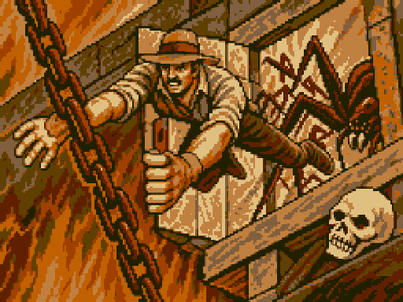
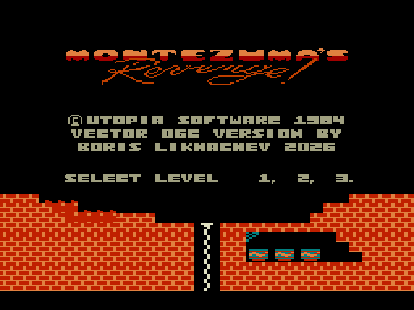
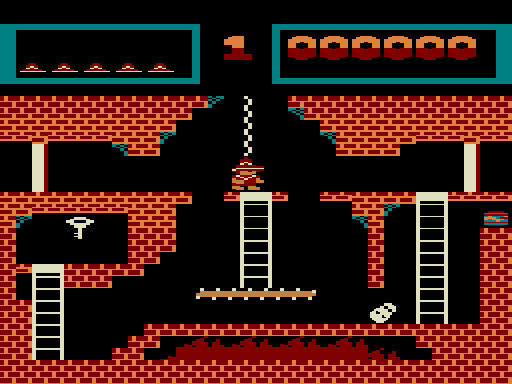
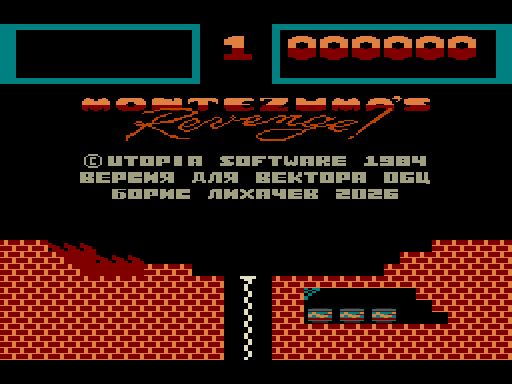
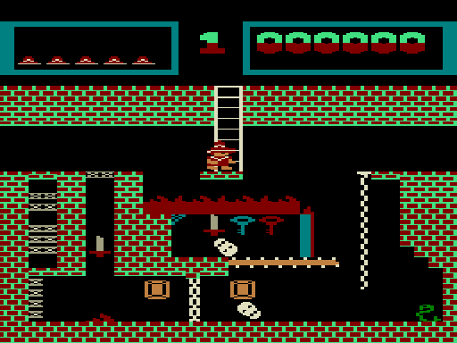
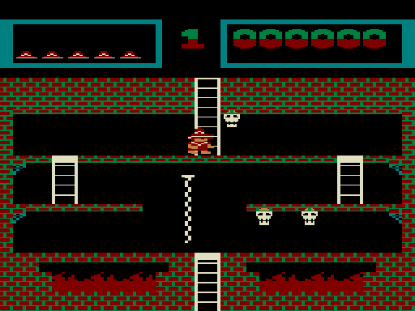
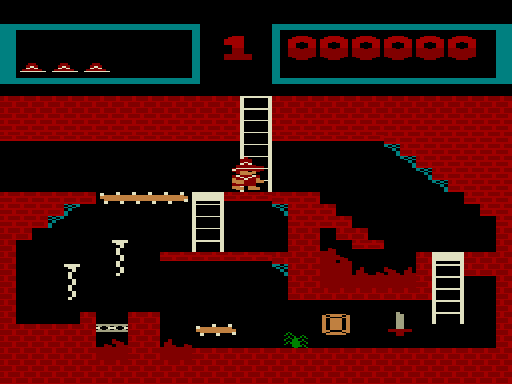
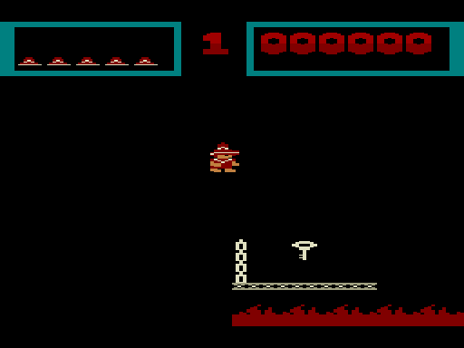
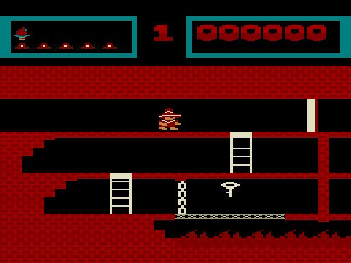

# Montezuma's Revenge — порт на Вектор-06Ц

**Montezuma's Revenge** (Utopia Software / Parker Brothers, 1984) на ванильном **Векторе-06Ц**: i8080 3 МГц,
64 КБ, без квазидиска и переходников. За основу взята версия для NES: её оформление, все 99 комнат пирамиды,
сокровищница, предметы, враги и музыка. Движок написан заново на i8080; движение Джо, прыжки, лестницы,
канаты, конвейеры, исчезающие платформы и столкновения сверены шаг в шаг с кодом 6502 оригинала
(стенды `tools/bench`, аудиты `tools/nes/diff_audits.sh`). Вывод, звук, ввод и заставка — свои, под Вектор.

| Заставка | Титул | Начало (уровень 1) |
|---|---|---|
|  |  |  |

| Русская версия |
|---|
|  |

| Комната с цепями | Черепа и канат | Нижние этажи |
|---|---|---|
|  |  |  |

| Тёмная комната без факела | Та же комната с факелом |
|---|---|
|  |  |

## Готовые образы

Образ памяти **с адреса 0x0000** (формат `.C00` / `.r0m`, 64 КБ): на MiSTer (ядро Vector-06C) открывается
через меню ядра как `.C00`, в эмуляторах (Emu80, vector06js) — как `.r0m`.

| Файл | Что это |
|---|---|
| [`rom/Monty-v06c.c00`](rom/Monty-v06c.c00) | для MiSTer |
| [`rom/Monty-v06c.r0m`](rom/Monty-v06c.r0m) | то же для эмуляторов |
| [`rom/Monty-v06c.mgl`](rom/Monty-v06c.mgl) | ярлык MiSTer (ждёт `games/VECTOR06/Monty-v06c.c00`) |
| [`rom/Monty-v06c-rus.c00`](rom/Monty-v06c-rus.c00), [`.r0m`](rom/Monty-v06c-rus.r0m), [`.mgl`](rom/Monty-v06c-rus.mgl) | русская версия (титры, «ИГРА ОКОНЧЕНА») |

Остальные файлы в `rom/` — промежуточные сборки (`Monty-v06c-nes3-fixN.r0m`), история правок по ним —
в `docs/BUGS.md`. Текущий образ соответствует `Monty-v06c-nes3-fix37.r0m` (русский — `fix37-rus`).

## Управление

Заставка — **пробел** или «огонь» джойстика. На титуле в HUD показаны рекорд и уровень: стрелки выбирают
уровень, пробел/«огонь» — старт. Тренер: на титуле нажать **F1+F3** — старт уровня 1 без потери жизней,
клавиша **Л** (L) переводит на следующий уровень.

| действие | клавиатура | джойстик «П» |
|---|---|---|
| влево, вправо | ← → | влево, вправо |
| вверх, вниз (лестницы, канаты, цепи) | ↑ ↓ | вверх, вниз |
| прыжок | пробел | огонь |
| пауза / дальше | ВК | |
| из паузы — на титул | АР2 | |
| музыка вкл/выкл (эффекты звучат всегда) | УС | |

Джойстик «П» (порт 06, а также порт 0E) работает наравне с клавиатурой: отклонения — движение, кнопка — прыжок.

## Что по-другому, чем на NES

- **Экран.** Кадр NES 256×240 выводится без масштабирования на полном растре Вектора 256×256:
  HUD на шесть строк (счёт, уровень, предметы, запасные жизни шляпами), ниже поле 256×192.
  Цветов восемь вместо палитры NES: цвета комнаты, кирпичи, Джо в трёх цветах (белый, кожа, красный),
  серый слот для мечей, исчезающих платформ и дыма при гибели; колонны белые с оранжевой полосой.
- **Темп.** Игра идёт ровно 37,5 шага/с во всех комнатах (NES — 60 кадров/с): Вектор не успевает делать
  шаг каждый кадр в комнатах с несколькими врагами, поэтому темп выбран по самой тяжёлой комнате.
- **Логика.** Всё поведение пересчитано по дизассемблированному коду NES: физика Джо, автомат предметов
  (ключи, двери, меч, факел, амулет), снятие змей при гибели на уровнях 1–4, сокровищница с процедурной
  россыпью драгоценностей, девять уровней прохождения.
- **Звук на ВИ53.** Темы титула (играет на титуле и после GAME OVER), пирамиды (в игре) и сокровищницы
  переложены с NES на два канала ВИ53.
  Эффекты (шаги, прыжок, подбор, двери, гибель) — на ВИ53 и динамике.
- **Заставка** — 16-цветная картинка на весь экран (`assets/`), сжата ZX0 и показывается один раз при
  загрузке ROM; после пробела распаковывается сама игра.
- **Память.** 64 КБ заняты почти целиком: кэш образов тайлов, готовые сдвиги спрайтов врагов, два
  образа Джо. Как это уложено и что проверялось — `docs/MEMORY_HUNT.md`, `docs/FRAME_BUDGET.md`.

## Сборка

Нужны Python 3 с Pillow, Node.js, C-компилятор (ZX0 из `tools/nes/zx0` собирается сам в `build/nes_title/zx0`)
и sjasmplus (`tools/sjasmplus`, сборка macOS).
Оригинальный ROM NES в репозиторий **не входит**: для полной пересборки нужен `orig/nes/monty.nes`
(из него `tools/nes/extract.py` и `tools/nes/music/extract_music.py` берут тайлы, комнаты, спрайты и музыку).
Готовые извлечённые данные для ассемблера лежат в `src/native/gen/`.

```sh
sh tools/nes/build_native.sh                      # полная сборка из оригинала: данные, Джо, титул, музыка, проверки
python3 tools/nes/music/to_vi53.py                # музыка ВИ53 и пул сдвигов (при правке)
sh tools/nes/quick_build.sh build/quick           # быстрая сборка -> build/quick/monty.bin
python3 tools/nes/build_splash.py --build build/quick --output rom/Monty-v06c.r0m --quick   # образ с заставкой
sh tools/nes/build_rus.sh build/rus rom/Monty-v06c-rus.r0m   # русская версия
```

Проверки: `B=build/quick node tools/bench/<стенд>.js` (стенды `tools/bench/nes-*.js`),
физика против NES — `B=build/quick sh tools/nes/diff_audits.sh`, скорость — `tools/bench/walk-cost.js`.
Запуск без окна в Emu80: `ROM=Monty-v06c.r0m sh tools/emu80_run.sh`.

## Документация

- `docs/NES_NATIVE.md` — устройство NES-сборки: экран, Джо, кэш, звук, стенды.
- `docs/BUGS.md` — журнал исправлений по образам fix1…fix37.
- `docs/FRAME_BUDGET.md`, `docs/MEMORY_HUNT.md`, `docs/VI53_MUSIC.md`, `docs/NES_MUSIC.md` — такты, память, музыка.
- `docs/DISASM.md`, `docs/PORT_DESIGN.md` — ранний этап: разбор MSX/ColecoVision-версии, с которой порт начинался.

Папки `orig/`, `build/`, `archive/`, `ref/` в git не входят.
